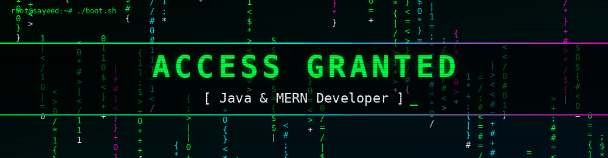

<!-- ═══════════ HEADER ═══════════ -->


<div align="center">

```
 ███████╗ █████╗ ██╗   ██╗███████╗███████╗██████╗ 
 ██╔════╝██╔══██╗╚██╗ ██╔╝██╔════╝██╔════╝██╔══██╗
 ███████╗███████║ ╚████╔╝ █████╗  █████╗  ██║  ██║
 ╚════██║██╔══██║  ╚██╔╝  ██╔══╝  ██╔══╝  ██║  ██║
 ███████║██║  ██║   ██║   ███████╗███████╗██████╔╝
 ╚══════╝╚═╝  ╚═╝   ╚═╝   ╚══════╝╚══════╝╚═════╝ 
```

[](https://git.io/typing-svg)

<table>
<tr>
<td align="center" width="260">

<br/>
<code>root@sayeed:~#</code>
</td>
<td align="left" valign="middle">

```bash
● ● ●  sayeed@kali: ~

$ whoami
sayeed_alam

$ cat role.txt
Java & MERN Developer

$ echo $LOCATION
Bengaluru, India 🇮🇳

$ echo $STATUS
[ONLINE] building · learning · shipping 🚀
```

</td>
</tr>
</table>

   


<br/>

<a href="https://www.linkedin.com/in/sayeed-alam-b3711622a/"></a>
&nbsp;&nbsp;
<a href="https://github.com/Sayeed848"></a>
&nbsp;&nbsp;
<a href="mailto:sydrj116@gmail.com"></a>

</div>


## 👾 `> cat about_me.txt`


### Hey 👋, I'm [Sayeed Alam](https://github.com/Sayeed848)

Hi, I'm Sayeed — a passionate **Java & MERN Developer** from Siwan, Bihar, now based in **Bengaluru**. I build responsive front-end interfaces, develop RESTful APIs and work with relational databases. Currently a **Software Engineer Intern at Tek Pyramid**, where I work on application modules, code reviews and Agile workflows. Fascinated by solving problems and accepting new challenges — looking for opportunities to grow with innovative teams.

> *"Talk is cheap. Show me the code."* — Linus Torvalds

**Talking about Education / Skills:**

- 🎓 B.Tech from Bihar Engineering University (BEU), class of 2024
- ☕ Java, JavaScript, TypeScript
- 🌐 HTML, CSS, Bootstrap, Tailwind CSS, React.js
- ⚙️ Core Java, JDBC, Node.js, Express.js, RESTful APIs
- 🗄️ MongoDB, MySQL
- 🛠️ Git, GitHub, Postman, VS Code, Claude AI
- 💬 Ask me about anything, I am happy to help
- 📫 How to reach me: [sydrj116@gmail.com](mailto:sydrj116@gmail.com)

<br clear="right"/>


## 🧬 `> cat SayeedAlam.java`

```java
public class SayeedAlam {

    private String role      = "Java & MERN Developer";
    private String currently = "Software Engineer Intern @ Tek Pyramid, Bengaluru";
    private String from      = "Siwan, Bihar, India";
    private String education = "B.Tech (BEU, Bihar) — 2024";

    private String[] languages = {"Java", "JavaScript", "TypeScript"};
    private String[] frontend  = {"React.js", "Tailwind CSS", "Bootstrap", "HTML5", "CSS3"};
    private String[] backend   = {"Core Java", "JDBC", "Node.js", "Express.js", "RESTful APIs"};
    private String[] database  = {"MongoDB", "MySQL"};
    private String[] tools     = {"Git", "GitHub", "Postman", "VS Code"};

    public String currentFocus() {
        return "Building full stack apps with Java & the MERN stack";
    }

    public String lookingFor() {
        return "Opportunities to build real products with great teams 🚀";
    }
}
```


## ⚡ `> ls ./tech_stack`

<div align="center">

**// Languages**


**// MERN Stack**


**// Frontend**


**// Backend & APIs**


**// Tools**


</div>


## 🔍 `> nmap --skills sayeed`

```bash
$ nmap -sV --skills sayeed.local
Starting scan... 6 services detected

PORT   STATE  SERVICE        SKILL LOAD
8080/  open   Java           [████████████████░░░░] 80%
3000/  open   React.js       [███████████████░░░░░] 75%
5000/  open   Node/Express   [█████████████░░░░░░░] 65%
27017/ open   MongoDB        [████████████░░░░░░░░] 60%
3306/  open   MySQL / JDBC   [█████████████░░░░░░░] 65%
443/   open   REST APIs      [████████████████░░░░] 80%

Scan complete: 6 open ports · 0 filtered · still upgrading 🔧
```


## 🚀 `> ./run_projects.sh`

<table>
<tr>
<td width="50%" valign="top">

### 🛒 ApnaTokri
**Grocery & Quick-Commerce Web App**

- Responsive Home, Categories & Product modules
- Product filtering, product details & cart
- REST API integration with async JavaScript
- React Router + Context API for state


</td>
<td width="50%" valign="top">

### 🛍️ ShopZone
**E-Commerce Frontend Website**

- Fully responsive product listing UI
- Category filtering with live DOM manipulation
- Add-to-cart, discount badges & star ratings
- Clean navbar, hero banner & product cards


</td>
</tr>
</table>

### 💻 Recent projects on my [GitHub](https://github.com/Sayeed848/)

<!-- ⚠️ Change repo=... to your exact repository names -->
<a href="https://github.com/Sayeed848/ShopZone">
  
</a>
<a href="https://github.com/Sayeed848/ApnaTokri">
  
</a>
<br clear="all"/>
<a href="https://github.com/Sayeed848/S-Cash">
  
</a>
<br clear="all"/>


## 🛰️ `> git log --career`

```diff
+ 2026 – Present  | Software Engineer Intern @ Tek Pyramid, Bengaluru
                   → Java, RESTful APIs, modern frontend, Agile & code reviews

! 2023            | Cisco AICTE Virtual Internship — Completed ✔

# JSpiders        | Java Full Stack Development Training
                   → Core Java, JDBC, REST APIs, HTML, CSS, Bootstrap, JavaScript

- 2020 – 2024     | B.Tech — Bihar Engineering University (BEU)
```


## 📊 `> cat /proc/github_stats`

<div align="center">


</div>


## 📡 `> ping sayeed --connect`

<div align="center">

[](mailto:sydrj116@gmail.com)
[](https://www.linkedin.com/in/sayeed-alam-b3711622a/)
[](https://github.com/Sayeed848)
[](tel:+919122312432)

📌 Star and Fork this README ✏️

</div>

---

<div align="center">

```bash
$ echo "Code. Break. Debug. Repeat." && sudo make --me-a-better-developer
> Compiling dreams... [██████████████████░░] 90%
> Connection closed. See you in the next commit 👾
```


</div>
